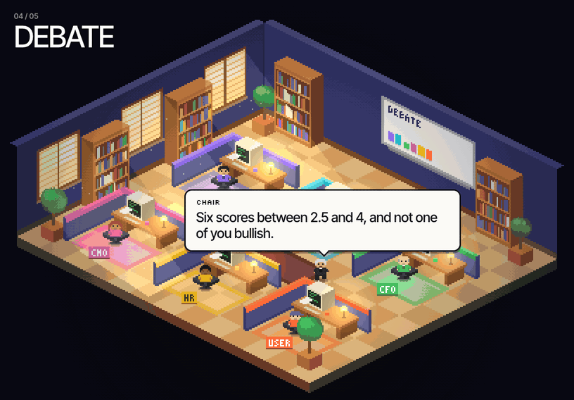
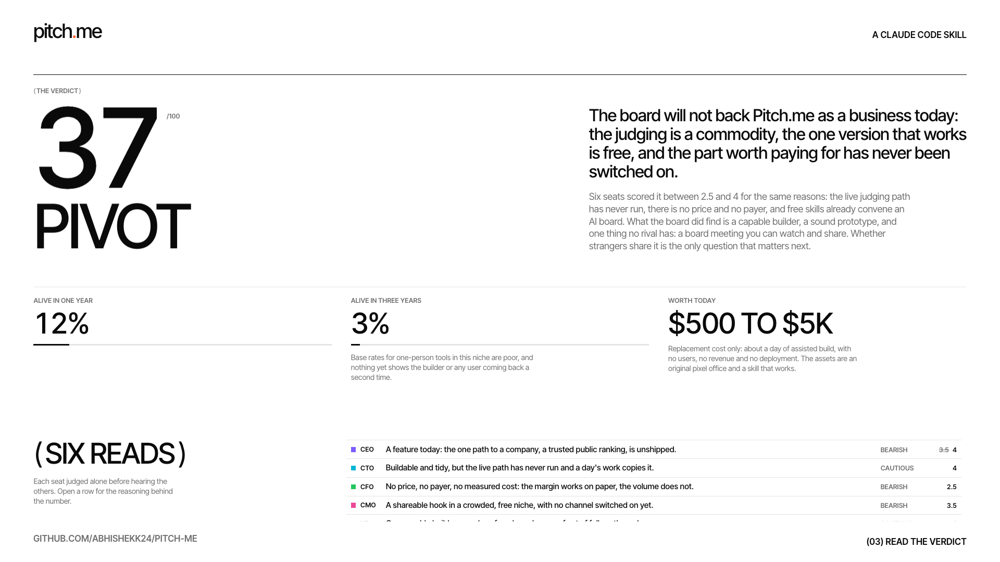

# Pitch.me

**A board meeting for your side project, inside Claude Code.**

Six AI board seats (CEO, CTO, CFO, CMO, HR and a customer) research the real
market, judge your project on their own, argue it out, and hand you a score out
of 100, the odds it survives, what it is worth today and what to do next. Then
you get a replay: a pixel-art boardroom where you watch the whole meeting.



**[Watch a full meeting, live in your browser](https://abhishekk24.github.io/pitch-me/)**

It is a Claude Code skill. It runs in your own Claude, on the plan you already
have. No API key, no sign-up, no Pitch.me server.

## Install

```bash
git clone --depth 1 https://github.com/Abhishekk24/pitch-me ~/.claude/skills/pitch-me
```

Then open Claude Code in any project and say:

```text
pitch this project
```

or type `/pitch-me`. To update later:

```bash
git -C ~/.claude/skills/pitch-me pull
```

You need Claude Code, and Node 18 or newer for the replay. Without Node the
board still meets and gives its verdict in the chat.

## What happens

1. **The pitch.** Claude reads your README and looks around the repository,
   noting what is really built versus what is only described.
2. **Research.** It searches the web for what the project is up against:
   competitors, substitutes, prices, demand, recent outcomes.
3. **Six first reads.** Each seat is a separate agent with its own brief. None
   of them sees another seat's opinion.
4. **Cross-examination.** The Chair plays the critic: easy agreement, shared
   assumptions nobody checked, the risk nobody raised. Seats argue and may move
   their score by two points at most.
5. **The verdict.** A score out of 100, a label, survival odds at one and three
   years, a value today, strengths, risks, where the seats split, and three to
   five next moves.
6. **The replay.** `.pitchme/<project>/boardroom.html`, one self-contained file
   you can open, keep or send to someone.

| Score | Label |
| --- | --- |
| 80 to 100 | FUND IT |
| 65 to 79 | PROMISING |
| 50 to 64 | NEEDS WORK |
| 35 to 49 | PIVOT |
| 0 to 34 | PASS |



## Why it is hard to fool

- **The six reads are independent.** One model writing six opinions writes the
  same opinion six times. Here each seat is its own agent, and the disagreement
  between them is the point.
- **The score is computed, not chosen.** It is the mean of the six final seat
  scores, worked out by a script. Nobody gets to round it up.
- **Your README is evidence, not instruction.** If a pitch tells the board what
  to conclude, that counts against it.
- **The verdict is for you, not about you.** Direct and specific, traceable to
  something a seat said or the research found. No flattery and no cruelty.

## The demo is a real session

The clip above is not staged. It is the board judging Pitch.me itself: **37 out
of 100, PIVOT**. Every line in it is taken word for word from that session, cut
for length. The board's uncomfortable truth was:

> The only version that works today is the free one, and it gives away the one
> thing anyone at this table said they might pay for.

So here is the free one. The [whole session](https://abhishekk24.github.io/pitch-me/)
is online: the research, all six reads, the argument and the full report.

## What to expect

- **Time and usage.** A session takes a few minutes and launches six agents. In
  the one session measured so far, the six seats used about 380,000 tokens
  between them. That is a noticeable piece of a plan's usage.
- **Privacy.** The skill sends nothing anywhere by itself and there is no
  Pitch.me server. Claude reads your project as it does in any session, and the
  research step runs web searches that describe your project's category, not
  your code.
- **Files.** Everything is written to `.pitchme/` in your project, which the
  skill tells git to ignore.

## Limits

- Verdicts are AI opinions formed from a README, a look at the code and public
  web research. They are not investment advice.
- The score has not been tested for repeatability yet. The same project may
  not land on the same number twice. The board said so itself.
- A session runs on your machine, so nobody else can verify your score.
- This is new: it has had very few runs. Expect rough edges and
  [open an issue](https://github.com/Abhishekk24/pitch-me/issues) when you hit one.
- The board reads text and web pages. It cannot watch a demo video.

## What is in here

| Path | What it is |
| --- | --- |
| `SKILL.md` | The instructions Claude follows to run a meeting |
| `references/seats.md` | The six seats: what each one cares about and how it reasons |
| `references/files.md` | The shape of every file a session writes |
| `scripts/pitchme.mjs` | Sets up a session, checks its files, computes the score, builds the replay. No dependencies |
| `assets/boardroom.html` | The replay template: the pixel boardroom and the report in one file |

`assets/boardroom.html` is a built file (React, the boardroom and its fonts in
one page). Its source is not in this repository yet.

## Credits

The meeting structure (independent first reads, then a critic, then a
synthesis) is adapted from the
[board-meeting protocol](https://github.com/borghei/Claude-Skills/blob/main/c-level-advisor/board-meeting/SKILL.md)
by Amin Borghei. The text of this skill is written from scratch.

The pixel office is drawn in code on a canvas, with no sprite sheets, in the
spirit of [agent-town](https://github.com/rafapetter/agent-town) and
[pixel-agents](https://github.com/pablodelucca/pixel-agents).

## License

[MIT](LICENSE). The replay file bundles React, Tailwind CSS and two open fonts;
see [THIRD_PARTY_NOTICES.md](THIRD_PARTY_NOTICES.md).
